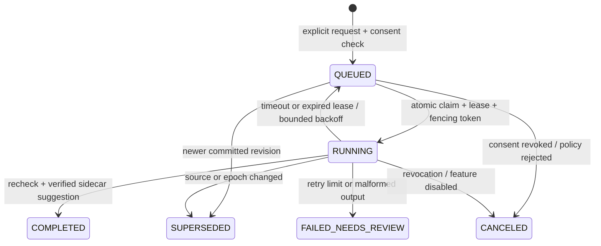

# Phase 09A — AI Auto Organize foundation

**Status:** Synthetic source implementation complete; production inactive.  
**Baseline:** `0393741e9ef422269a92edb5bb5b24933ef86436` (`main`, matched `origin/main` after fetch).  
**Scope:** Foundation contracts, additive SQLite schema and deterministic verification. No inference service, UI, provider network access, production migration, or rollout.

## Source invariants recorded from the pre-edit inspection

- Sync Protocol v1 accepts a strict note-only push envelope. `sync_changelog.entity_type` is constrained to `note` or `recording`; changing it would require a protocol migration.
- A valid text push commits its immutable `record_json` changelog event, `sync_entities` row, idempotency receipt, server version and cursor in one SQLite `BEGIN IMMEDIATE` transaction.
- The Sync database is schema v2 today. Audio migration `003-audio.sql` advances `PRAGMA user_version` and `sync_server_meta.schema_version` to v3; production Audio migration remains separately gated and postponed.
- Web local saves are authoritative and revision checked. AI must not edit IndexedDB, canonical note JSON, note tags/lifecycle, Sync versions, or the changelog.
- Privacy is explicit. Missing privacy and `DEVICE_ONLY` are excluded from server Sync; `PRIVATE_SERVER` and `CLOUD_ALLOWED` do not mean AI consent.
- Existing organization rules allow up to 20 normalized unique tags, 32 characters per tag. Canonical Note v1 has no category property.
- The active production Web container is not rebuilt automatically from source. Audio remains disabled.
- The inspected iPhone prototype has no native Sync API client. No consent transfer or mobile-to-Mac revision path was found.

## Architecture decisions and R11 reconciliation

1. AI consent is a separate, per-note row with an explicit scope, provider boundary, state, and monotonically increasing consent epoch. There is no migration backfill or blanket historical consent.
2. AI jobs bind to a committed immutable changelog row by server epoch, cursor, server version and content hash. The job stores no note body, prompt, or duplicate full text.
3. Jobs, dedupe identity and enqueue audit insert in one SQLite transaction. This foundation exposes an explicit server-version-bound enqueue function; ordinary Text Sync push does not enqueue. The enqueue transaction is not yet joined to the original note commit because Sync v1 has no explicit AI-request/consent contract. Do not claim that cross-transaction atomicity is solved.
4. The AI schema has its own `ai_schema_migrations` ledger and is applied only by an explicit migration function. It never changes `PRAGMA user_version`, `sync_server_meta`, or the audio migration. The application store initializer does not call it.
5. Queue state is `QUEUED → RUNNING → COMPLETED`, with `FAILED_NEEDS_REVIEW`, `SUPERSEDED`, and `CANCELED` terminal/review paths. Claims use `BEGIN IMMEDIATE`, random fencing tokens, expiring leases, at most five attempts, and capped exponential backoff. A single-job call is externally/event triggered; there is no polling loop.
6. Before dispatch and before publishing, the queue rechecks feature flags, server epoch, exact source revision/hash, active lifecycle, consent state/epoch, and the claim token. Results after revocation, source change, epoch change, or lease loss are discarded.
7. The only implemented provider adapter is an injected in-process Mock Provider, and the job runner refuses to execute it unless `NODE_ENV=test`. The production code has no AI route, gateway URL, HTTP client, fallback, credentials, tool calls, or network request. `STRICT_LOCAL` requires an explicit attestation decision and is not implemented; external cloud execution is rejected in 09A even with a cloud grant.
8. Category, summary, tasks, tags, and related-note proposals remain derived sidecar data. No apply workflow is present. Related candidates are deterministic title/tag matches and require a caller-supplied per-candidate consent check.

This follows the R11 privacy, immutable-source, sidecar, and fenced-queue findings. It narrows R11's proposed “outbox in the note commit” until AI consent and request intent have a versioned client contract; no AI work is enqueued merely because Text Sync pushes a note. R11's Mac worker/API and local Gateway are deferred, consistent with 09A's no-inference boundary. The foundation does not imply that mobile Sync, Gateway access, local hardware execution, or production migration is ready.

## Consent and provider matrix

| Note privacy | Consent | 09A Mock | Proven local provider | External cloud provider |
|---|---|---:|---:|---:|
| Missing / unknown | Any | Reject | Reject | Reject |
| `DEVICE_ONLY` | Any | Reject | Reject | Reject |
| `PRIVATE_SERVER` | None / revoked | Reject | Reject | Reject |
| `PRIVATE_SERVER` | `APPROVED_LOCAL_ONLY` | Synthetic Mock lane only | Future only after local execution proof | Reject |
| `PRIVATE_SERVER` | `APPROVED_CLOUD_ALLOWED` | Reject | Reject | Reject |
| `CLOUD_ALLOWED` | None / revoked | Reject | Reject | Reject |
| `CLOUD_ALLOWED` | `APPROVED_LOCAL_ONLY` | Synthetic Mock lane only | Future only after local execution proof | Reject |
| `CLOUD_ALLOWED` | `APPROVED_CLOUD_ALLOWED` | Synthetic Mock lane only | Future only after local execution proof | Reject in 09A; future remote grant must name the provider boundary |

Both `NOTEOS_AI_ORGANIZE_ENABLED` and `NOTEOS_AI_INFERENCE_ENABLED` default to `0`. Disabled calls do not create consent/jobs, run migrations, claim jobs, or call a provider. Text Sync remains independent.

## Schema and migration compatibility

Tables: `ai_schema_migrations`, `ai_note_consent`, `ai_jobs`, `ai_suggestions`, and `ai_audit_log`. The ledger is independent from SQLite's global version. All identifiers and enums are checked; jobs and audit rows have hard caps (10,000 each), active queue is capped at 1,000, suggestion payloads at 8 KiB, audit metadata at 1 KiB, and scopes at 512 bytes. Capacity exhaustion preserves existing audit/unresolved rows and rejects new work; no data is automatically purged.

Synthetic SQLite fixtures cover:

- Sync v2 + AI schema.
- Sync v3 + AI schema, including paired device and recording/media metadata.
- v2 → AI schema → Audio v3.
- v2 → Audio v3 → AI schema, with the AI migration applied after synthetic audio metadata exists.

All tested paths retain server epoch/cursor, paired device, text changelog/entity and existing recording/media rows; `PRAGMA foreign_key_check` is empty. The AI migration is not run by `openStore` and was not applied to the production database.

## Queue and publication contract

No provider runs inside a SQLite transaction. A stale worker cannot publish after its lease token changes. No suggestion updates a note; future application must be a client-authored, revision-CAS save followed by ordinary Sync and an auditable per-item decision.

## Mock Provider and output schema v1

The adapter contract carries an explicit boundary (`STRICT_LOCAL`, `EXTERNAL_CLOUD`, or `MOCK`) and only `MOCK` is accepted by the 09A worker. The mock receives one committed note, its source version and hash, and returns an object (or strict JSON string). It never invokes HTTP or a model.

The verifier accepts exactly these keys: `schemaVersion`, `categorySuggestion`, `tagCandidates`, `shortSummary`, `taskCandidates`, `relatedCandidates`, `insufficientContext`, and `uncertainty`. Category/tag/task quotes must be exact substrings of the source note. Tag proposals reuse the current normalization/maximum rules. Output depth, item counts, string sizes, total payload and Unicode/control characters are bounded. HTML, links, image references and external URLs are rejected from proposal strings. Related IDs must be in a separately authorized candidate set. Textual quote grounding demonstrates provenance only; it cannot establish semantic correctness.

## Client write authority and later protocol decision

No AI module imports the IndexedDB repository or writes Sync note tables. Sync Protocol v1 and its note/recording changelog constraint remain unchanged. A future apply contract is: open suggestion → check current local revision → owner approves specific items → client applies using the existing save mechanism → ordinary Sync operation → record a consistent suggestion decision. Phase 09C must choose either a versioned Sync protocol extension or independently synchronized AI metadata with deterministic reconciliation; it must also define how mobile consent reaches the Mac.

## Threat summary

- **Privacy escalation:** reject missing/unknown and `DEVICE_ONLY`; explicit per-note AI scope is mandatory; `CLOUD_ALLOWED` is not provider permission.
- **Remote boundary confusion:** no inference client exists; localhost/model names/headers are not attestation; cloud is rejected in this phase.
- **Prompt injection:** no LLM or prompt runs; note data is passed only to a local mock as data. A later prompt adapter needs an independent security gate.
- **Stale output/revocation race:** immutable source identity, consent epoch, repeated policy checks, lease expiry and fencing token.
- **Malformed/hallucinated output:** strict schema, bounds, exact quote provenance, inert-string validation; semantic truth remains unverified.
- **Unauthorized note changes:** sidecar-only suggestions; no write/apply path.
- **Resource exhaustion:** queue, attempts, lease duration, audit/job counts and payloads are bounded; exhaustion rejects new work without deleting unresolved evidence.
- **Cross-note leakage:** provider context is one note only. Related matching returns IDs/reasons only after per-candidate consent callback.

## Verification and operational status

See `evidence/test-results.md`, `evidence/build.log`, `evidence/docker-before-after.md`, and `implementation.diff` in the review ZIP. The focused test run covers policy/consent, queue races, retries, strict output checks, multilingual synthetic notes, migration orders, existing Text Sync, IndexedDB and Archive V2. The Next production build completed. It warned that multiple lockfiles caused Turbopack to infer the parent `gate1` root; compilation, type checking and route generation succeeded.

No Docker image was built and no Docker resource, container, volume or production service was modified. Host production health is a point-in-time observation only. Existing production Text Sync remains on and Audio Sync remains off. This does not authorize rollout or migration.

## Known blockers and 09B recommendation

**Phase 09A foundation:** safe to accept for code review after the commit and evidence bundle are inspected; it is default-off and has no production route.  
**Before a 09B/09C integration:** resolve how explicit AI request/consent is carried from Web and iPhone without silently changing Sync v1; decide whether enqueue must join the note-commit transaction; define owner/scope/retention; inspect worker topology and API authentication. The mobile Sync client is absent.  
**Before any real inference or pilot:** separately prove local execution and Gateway reachability or explicitly approve a remote provider, review logs/retention/secrets, run staged feature and migration review, obtain owner pilot approval, and verify actual-device paths as needed. Production schema v3 remains postponed and no AI schema migration has been deployed.
