# Phase 09B-0: AI Consent and Analysis Request Bridge

Status: **PASS for the synthetic MOCK bridge; BLOCKED for production enablement or inference.**

## Scope and invariants

This phase adds an authenticated, versioned AI API and a browser-side metadata outbox. It does not run jobs, invoke a provider, transfer note bodies to an AI endpoint, activate Audio Sync, or change the Sync v1 envelope/changelog. `NOTEOS_AI_ORGANIZE_ENABLED` and `NOTEOS_AI_INFERENCE_ENABLED` remain opt-in environment flags whose default is off. The bridge accepts only `executionBoundary: MOCK` and reports `inferenceAvailable: false`.

`DEVICE_ONLY` remains ineligible and its privacy value is never changed by this feature. The API reads committed note revisions from Sync storage; the browser can submit an analysis request only after the same local revision has a Sync baseline/ACK. A queued analysis row is only a synthetic request/job receipt; no worker is dispatched by the HTTP route.

## API contract v1

All paths are same-origin, `Cache-Control: no-store`, and behind `NOTEOS_SYNC_ENABLED=1` plus `NOTEOS_AI_ORGANIZE_ENABLED=1`. Mutations require an authenticated paired-device cookie scoped to `/api/v1/ai`, exact configured Origin/Host validation, `Sec-Fetch-Site` validation, `Content-Type: application/json`, and `X-NoteOS-AI: 1`. Payloads are strictly shaped and limited to 4 KiB. Authenticated requests share a SQLite per-device limit of 60 requests per rolling minute.

| Method and path | Purpose | Request fields | Result |
| --- | --- | --- | --- |
| `GET /api/v1/ai/status` | Discover feature state | none | `enabled`, `scope=organize`, `executionBoundary=MOCK`, `inferenceAvailable=false` |
| `GET /api/v1/ai/consents/{noteId}` | Read consent state | none | consent state, scopes, provider boundary, consent epoch |
| `PUT /api/v1/ai/consents/{noteId}` | Explicit version-bound grant | `protocolVersion`, `requestId`, `scope`, `executionBoundary`, `expectedServerEpoch`, `expectedServerVersion`, `expectedContentHash` | consent receipt and epoch |
| `DELETE /api/v1/ai/consents/{noteId}` | Revoke consent | `protocolVersion`, `requestId` | revoked state and epoch, or a failure if durable revoke did not commit |
| `POST /api/v1/ai/analysis-requests` | Explicit request for an already ACKed revision | `protocolVersion`, `requestId`, `noteId`, expected epoch/version/hash, `consentEpoch`, `scope`, `executionBoundary` | queued synthetic receipt; inference remains unavailable |
| `GET /api/v1/ai/analysis-requests/{requestId}` | Read request/job status | none | metadata only; no note content or suggestion payload |

Pairing continues to create the existing Sync cookie and additionally sets an HttpOnly, SameSite=Strict AI-path cookie containing the same paired-device token. `POST /api/v1/sync/ai-session` can mint that scoped cookie for an already paired browser without changing device state. Device revoke clears both cookies. No long-lived token is returned to JavaScript.

Requests are idempotent by UUID and actor device. Reuse with a different actor or body is rejected. Separate request IDs for the same analysis identity may reuse one deduplicated synthetic job, while each accepted request retains its own bounded metadata receipt.

## Request and revocation flow

```mermaid
stateDiagram-v2
  state "Consent" as Consent {
    [*] --> NONE
    NONE --> APPROVED_MOCK: explicit grant for committed revision
    APPROVED_MOCK --> REVOKE_PENDING: owner revokes locally
    REVOKE_PENDING --> REVOKED: durable server commit
    REVOKE_PENDING --> REVOKE_PENDING: offline or write failure; retry
    REVOKED --> APPROVED_MOCK: new explicit grant
  }
  state "One analysis request" as Request {
    [*] --> WAITING_FOR_SYNC: explicit user request
    WAITING_FOR_SYNC --> QUEUED: exact revision ACK and checks pass
    WAITING_FOR_SYNC --> STALE: note changes or epoch moves
    WAITING_FOR_SYNC --> CANCELED: user cancels or local revoke
    WAITING_FOR_SYNC --> NEEDS_CONSENT: server consent changes
    WAITING_FOR_SYNC --> ERROR: non-retryable server error
    QUEUED --> [*]: synthetic receipt only; no worker dispatch
    STALE --> [*]
    CANCELED --> [*]
    NEEDS_CONSENT --> [*]
    ERROR --> [*]
  }
```



```mermaid
sequenceDiagram
  participant UI as Browser UI
  participant IDB as IndexedDB metadata outbox
  participant Sync as Text Sync API
  participant AI as Authenticated AI API
  participant DB as SQLite Sync and AI tables
  UI->>AI: Explicit version-bound consent grant
  AI->>DB: Verify committed revision and record consent epoch
  UI->>IDB: Save explicit request intent (IDs and revision only)
  UI->>Sync: Normal Text Sync push
  Sync->>DB: Commit note revision and return ACK
  UI->>IDB: Store exact ACK baseline and server history
  UI->>AI: Submit metadata for the exact ACKed revision
  AI->>DB: Verify epoch, version, hash, privacy, consent epoch; enqueue MOCK receipt
  Note over AI,DB: No worker claim, model invocation, or provider egress
  UI->>IDB: On revoke, mark pending intents canceled and consent REVOKE_PENDING
  UI->>AI: Send durable revoke when online
  AI->>DB: Atomically revoke, advance epoch, cancel queued work, purge derived payloads
```

IndexedDB schema v6 adds `aiRequestOutbox` and `aiConsentCache`; rows contain only request/note IDs, local revision, consent epoch, scope, boundary and bounded status timestamps/receipts. They contain no title, document, note body, or media. Locally settled or delivered metadata is pruned oldest-first only to make room; active requests and pending revocations are never evicted. Intents survive reload, wait for exact ACK, become stale if the note changes, and are canceled locally before revoke is sent.

## SQLite migration and transaction boundaries

`002-ai-consent-bridge.sql` is independent of normal Sync initialization and adds the operation receipts, analysis request receipts, and bounded per-device API rate bucket. The API checks for migration version 2 and fails closed; it does not migrate storage at request time. Ordinary Text Sync initialization does not apply either AI migration. No Audio Sync v3 migration is invoked by this bridge.

Consent mutation plus idempotency receipt is one SQLite transaction. Analysis request validation, synthetic job insertion, audit record and request receipt share one transaction. Revocation advances the consent epoch, cancels queued/running jobs, clears derived suggestion payloads, and returns success only after commit. WAL readers on another SQLite connection observe committed revocation state. Sync metadata, server epoch, cursor, device pairing and canonical note records are not changed by consent/request receipt writes.

## Cross-process failure boundary

When a revoke transaction fails, the serving process latches the note in an in-memory fail-closed set and returns `AI_REVOCATION_NOT_PERSISTED`; it never acknowledges revoke success. A different Web process cannot observe that in-memory latch if SQLite itself cannot commit the durable revoked marker. This is a known **09B-1 blocker** for any inference-enabled deployment. Before inference is enabled, revocation needs a cross-process durable authority or an orchestrated global inference stop whose failure path is independently validated. Current safety depends on inference remaining disabled and the bridge not dispatching a worker.

## Verification summary

Evidence for this implementation is packaged in `artifacts/review/noteOS-Phase09B-0-AI-Consent-Request-Bridge-review.zip`. The focused server/client and compatibility suites, TypeScript, and production build are run against Node 24 in the Phase 00 Gate 1 Web workspace. Tests use synthetic fixtures and fake IndexedDB. No production database, real media, external provider, production container, Docker resource, or MemoryOS service is modified.

## Remaining blockers

- Do not enable inference or dispatch AI jobs until the 09B-1 cross-process revoke-failure boundary is closed and reviewed.
- AI migration v2 must be applied only through an explicitly reviewed future migration procedure; no production migration is included here.
- Browser/device-specific consent behavior still needs product/security review before any broader rollout.
